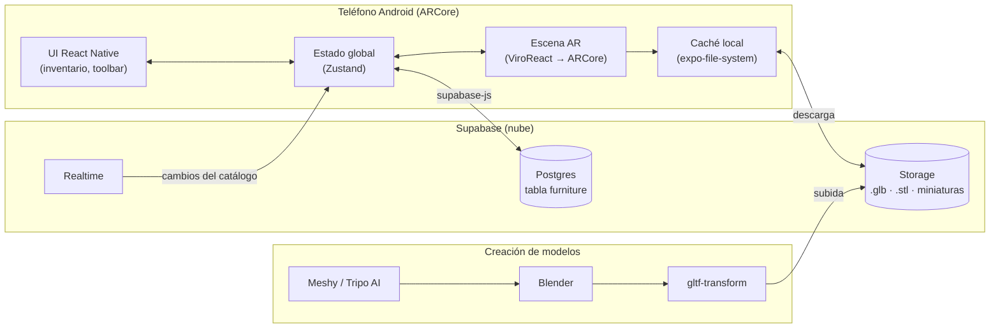

# Arquitectura — AR Furniture

Qué tecnologías usamos para construir la app, por qué las elegimos y cómo se conectan entre sí.
Cuando se agrega, cambia o quita una tecnología, se actualiza este archivo y se registra en la [BITACORA](BITACORA.md).

Estado de cada elemento: ✅ instalado / en uso · 🕓 planificado · ❌ descartado

---

## 1. Visión general



---

## 2. Decisiones de arquitectura

| # | Fecha | Decisión | Alternativas | Motivo |
|---|---|---|---|---|
| D1 | 2026-10-18 | No usar Unity; crear una app nativa Android desde VS Code | Unity + AR Foundation | Preferencia del proyecto: trabajar con un stack web/JS y Claude Code |
| D2 | 2026-10-18 | **React Native + Expo + ViroReact** | Flutter (`ar_flutter_plugin`, `arcore_flutter_plus`, `augen`), WebXR | Viro tiene mantenimiento activo y soporte para Expo; ya trae planos, *hit test*, gestos y screenshot. Los plugins AR de Flutter tienen mantenimiento irregular |
| D3 | 2026-10-18 | Plan B: Kotlin + **SceneView** (`arsceneview`) | — | La mejor calidad AR en Android si Viro se queda corto |
| D4 | 2026-10-18 | **Supabase** como backend | Firebase | SQL relacional para el catálogo; Storage gratuito sin tarjeta; funciona igual con `.glb` y `.stl` |
| D5 | 2026-10-18 | **Gitflow** + Conventional Commits + SemVer | Trunk-based | Versionamiento ordenado y versiones claras para Play Store |
| D6 | 2026-10-18 | Cada modelo en dos versiones: `.glb` para AR y `.stl`/`.3mf` para impresión 3D | Un solo archivo | La AR necesita modelos livianos; la impresión necesita alta resolución |
| D7 | 2026-10-18 | Fijar **Expo SDK 57** y Viro 3.0.3 | Expo SDK 58 (la más reciente) | Viro 3.0.3 solo soporta Expo 57 / RN 0.86 |
| D8 | 2026-10-18 | Dependencias y CLIs por proyecto (`node_modules`, `npx`); solo Node/JDK/SDK en el sistema | Instalaciones globales con `npm i -g` | Versiones reproducibles por proyecto (ver §6.3) |

---

## 3. Stack de la app

| Capa | Tecnología | Reemplaza (Unity) | Estado |
|---|---|---|---|
| Framework | **Expo SDK 57** (`expo` ~57.0.30) + React Native 0.86.3 (New Architecture) + React 19.2.3 | Proyecto Unity | ✅ |
| Build de desarrollo | `expo-dev-client` ~57.0.20 (Viro **no** funciona en Expo Go) | Build & Run | ✅ |
| Lenguaje | TypeScript ~6.0 (`strict`, alias `@/*` → `src/*`) | C# | ✅ |
| AR | `@reactvision/react-viro` **3.0.3** (versión exacta) → ARCore | AR Foundation + ARCore XR Plugin | ✅ |
| Navegación | `expo-router` ~57.0.28 (rutas en `src/app/`) | Escenas | ✅ |
| Lint | ESLint + `eslint-config-expo` (`npx expo lint`) | — | ✅ |
| Estado global | `zustand` | `GameManager` (singleton) | 🕓 |
| Animaciones UI | `react-native-reanimated` 4.5.1 (viene con la plantilla) | DOTween | ✅ |
| Gestos UI 2D | `react-native-gesture-handler` ~2.32.0 (viene con la plantilla) | — | ✅ |
| Imágenes | `expo-image` ~57.0.5 | RawImage | ✅ |
| Compartir foto | `expo-sharing` | NativeShare | 🕓 |
| Guardar foto | `expo-media-library` | — | 🕓 |
| Caché de modelos | `expo-file-system` | — | 🕓 |
| Backend | `@supabase/supabase-js` | Contenido remoto (cap. 8) | 🕓 |
| OTA (opcional) | `expo-updates` / EAS Update | — | 🕓 |
| Tests | `jest` + `@testing-library/react-native` | — | 🕓 |
| Build/Publicación | EAS Build + EAS Submit (`.aab`) | Build Settings Android | 🕓 |

**Compatibilidad (2026-10-18):** Viro 3.0.3 declara `expo >=57 <58` y `react-native >=0.86 <0.87`. Por eso el proyecto usa **Expo SDK 57** aunque la última versión publicada es la 58. **No actualizar Expo** hasta que Viro publique soporte para SDK 58. Viro va fijado sin `^` para que npm no lo suba por su cuenta.

**Configuración de Viro en `app.json`:** `android.xRMode: ["AR"]` (sin GVR/Cardboard). El plugin agrega el permiso `CAMERA` y declara ARCore como `optional`. Pasar a `required` en la Fase 9 si queremos que Play muestre la app solo en dispositivos con ARCore.

**Reglas de trabajo con Expo** (ver [`AGENTS.md`](../AGENTS.md)):
- Instalar paquetes con `npx expo install <paquete>`, no con `npm install`, para que se elija la versión compatible con el SDK.
- No editar `android/` a mano: se regenera con `npx expo prebuild`. La configuración nativa va en `app.json` y en los *config plugins*.
- Antes de cerrar una tarea: `npx tsc --noEmit`, `npx expo lint`, `npx expo-doctor`.

---

## 4. Backend (Supabase)

| Recurso | Uso | Estado |
|---|---|---|
| Tabla `furniture` | Catálogo: `id`, `name`, `description`, `thumbnail_url`, `model_url` (`.glb`), `print_url` (`.stl`/`.3mf`, opcional), `scale`, `active`, `updated_at` | 🕓 |
| Realtime | Avisar a la app cuando cambia el catálogo | 🕓 |
| Bucket `models` | `.glb` (AR) y `.stl`/`.3mf` (impresión) | 🕓 |
| Bucket `thumbnails` | Miniaturas del inventario | 🕓 |
| Edge Functions (futuro) | Automatizar la generación con las APIs de Meshy/Tripo | 🕓 |

**Límites del plan gratuito:** 500 MB de base de datos, 1 GB de Storage, **50 MB por archivo**. El proyecto se pausa tras ~1 semana sin actividad (se reactiva desde el panel).

---

## 5. Flujo de modelos 3D

```
Meshy / Tripo AI ──► Blender (limpieza, escala real en metros, pivote en la base)
                        ├──► .stl / .3mf  alta resolución, sólido y "watertight" ─► impresión 3D
                        └──► .glb  decimado (≤ ~50k triángulos, texturas ≤ 1024 px)
                                 └─► gltf-transform optimize ─► AR (< 5 MB)
```

| Herramienta | Uso | Estado |
|---|---|---|
| Meshy | Generar modelos 3D con IA | 🕓 |
| Tripo AI | Generar modelos 3D con IA | 🕓 |
| Blender (Windows) | Limpieza, escala, pivote, exportación | 🕓 |
| `@gltf-transform/cli` | Optimizar `.glb` | 🕓 |

---

## 6. Entorno de desarrollo

### 6.1 Sistema

| Elemento | Versión / Ubicación | Estado |
|---|---|---|
| Windows + WSL2 | Ubuntu 26.04 LTS | ✅ |
| Node.js | v24.22.0 LTS (vía nvm, `~/.nvm`) | ✅ |
| npm | 11.19.1 | ✅ |
| JDK | OpenJDK 17.0.20 (`JAVA_HOME=/usr/lib/jvm/java-17-openjdk-amd64`) | ✅ |
| Android SDK | `ANDROID_HOME=~/Android/Sdk` | ✅ |
| ├ cmdline-tools | latest | ✅ |
| ├ platform-tools (adb) | 37.0.1 | ✅ |
| ├ platforms | android-36 | ✅ |
| └ build-tools | 36.0.0 | ✅ |
| git | 2.53.0 | ✅ |
| git-flow | 1.12.3 (AVH) | ✅ |
| GitHub CLI (`gh`) | 2.46.0, cuenta `Ssalazarp420` | ✅ |
| `eas-cli` | Sin instalación global: se usa `npx eas-cli@latest` | 🕓 |

### 6.2 Dispositivo de pruebas

| Campo | Valor |
|---|---|
| Modelo | Xiaomi Redmi Note 11 (`2201117TL`, `spes_global`) |
| Android | 13 (API 33) |
| ARCore | Servicios de Google Play para RA 1.57 |
| Conexión | Depuración inalámbrica de adb (`adb pair` + `adb connect`) desde WSL2 |

> El puerto de `adb connect` cambia cada vez que se reactiva la depuración inalámbrica. Si `adb devices` aparece vacío, vuelve a conectar con el puerto que muestra el teléfono.

### 6.2.1 Ciclo de desarrollo en el teléfono

| Paso | Comando | Cuándo |
|---|---|---|
| Compilar e instalar el *development build* | `npx expo run:android` | Al inicio, y cada vez que cambie código **nativo**: nueva librería nativa, cambios en `app.json` o en *config plugins* |
| Redirigir Metro al teléfono | `adb reverse tcp:8081 tcp:8081` | Cada vez que se reconecta adb |
| Servidor de desarrollo | `npx expo start --dev-client --localhost` | Cada sesión. Los cambios en JS/TS se ven al instante, sin recompilar |

**Datos del build (Fase 1):** `compileSdk` 36, `targetSdk` 36, `minSdk` 24, NDK 27.1.12297006, CMake 3.22.1, Gradle 9.3.1. Solo compila `arm64-v8a` (la ABI del dispositivo conectado). El primer build tarda ~15 min; los siguientes ~5 min. El APK debug pesa ~106 MB.

**MIUI bloquea `adb install`** (`INSTALL_FAILED_USER_RESTRICTED`), aun con "Instalar vía USB" activado, por el aviso de confirmación. Solución:
```bash
adb push android/app/build/outputs/apk/debug/app-debug.apk /sdcard/Download/ar-furniture-dev.apk
```
Después se instala desde *Archivos → Descargas* en el teléfono.

### 6.3 ¿Global o por proyecto?

En JavaScript, cada proyecto ya trae su propio "entorno virtual": la carpeta `node_modules/`. Es el equivalente a un `venv` de Python, pero se crea solo con `npm install`.

| Qué | Dónde | Por qué |
|---|---|---|
| Librerías de la app (Expo, Viro, Zustand…) | **Proyecto** (`package.json` + `node_modules/`) | Cada proyecto fija sus versiones; `package-lock.json` garantiza que todos instalen exactamente lo mismo |
| CLIs del proyecto (`expo`, `eas-cli`, `expo-doctor`, `gltf-transform`) | **Proyecto o `npx`**, nunca `npm i -g` | Una CLI global queda con una sola versión para todos tus proyectos y se desincroniza |
| Versión de Node | **Global con nvm**, fijada por proyecto en `.nvmrc` (`24`) | `nvm use` dentro de la carpeta activa la versión correcta |
| JDK 17, Android SDK, git, git-flow, gh | **Global (sistema)** | Son herramientas del sistema, pesadas y compartidas; Gradle elige las versiones del SDK que necesita |
| Extensiones de VS Code | **Globales en el editor**, recomendadas por proyecto en `.vscode/extensions.json` | VS Code no tiene extensiones por proyecto, pero la recomendación le avisa a quien clone el repo |
| Servicios (Supabase, EAS, Play Console) | **Cuenta**, con claves en `.env` (fuera de git) | Las claves nunca se suben al repo |

### 6.4 Extensiones de VS Code

Recomendadas en [`.vscode/extensions.json`](../.vscode/extensions.json):

| Extensión | ID |
|---|---|
| WSL | `ms-vscode-remote.remote-wsl` |
| Claude Code | `anthropic.claude-code` |
| Expo Tools | `expo.vscode-expo-tools` |
| React Native Tools | `msjsdiag.vscode-react-native` |
| ESLint | `dbaeumer.vscode-eslint` |
| Prettier | `esbenp.prettier-vscode` |
| glTF Tools | `cesium.gltf-vscode` |
| Error Lens | `usernamehw.errorlens` |

---

## 7. Estructura del proyecto

```
App_realidad_aumentada/
├── src/
│   ├── app/                # Rutas (expo-router): cada archivo es una pantalla
│   │   ├── _layout.tsx     # Stack de navegación                  ✅
│   │   ├── index.tsx       # Inicio                               ✅
│   │   └── ar.tsx          # Pantalla AR (ViroARSceneNavigator)   ✅
│   ├── ar/                 # Escenas y objetos 3D
│   │   ├── HelloCubeScene.tsx  # Escena de prueba de la Fase 1    ✅
│   │   └── FurnitureScene, PlacedObject, Reticle               🕓
│   ├── ui/                 # InventoryPanel, ItemButton, Toolbar 🕓
│   ├── state/useAppStore.ts                                     🕓
│   ├── data/               # catalog.local.ts, catalog.remote.ts 🕓
│   └── types.ts                                                 🕓
├── assets/images/          # Ícono y splash                       ✅
├── assets/models/          # .glb locales                        🕓
├── assets/thumbnails/                                           🕓
├── docs/                   # PLAN · ARQUITECTURA · BITACORA       ✅
├── android/                # Generado por prebuild (fuera de git)
├── .claude/settings.json   # Activa el plugin oficial de Expo para Claude Code ✅
├── .vscode/                # Extensiones recomendadas + ajustes   ✅
├── AGENTS.md               # Reglas de Expo para asistentes de código ✅
├── app.json                # Config Expo + plugin Viro            ✅
├── eas.json                # Perfiles de build EAS                🕓
├── eslint.config.js · tsconfig.json · .nvmrc                    ✅
└── package.json · package-lock.json · README.md                 ✅
```

---

## 8. Versionamiento (Gitflow)

Repositorio: https://github.com/Ssalazarp420/App_realidad_aumentada (público, rama por defecto `develop`)

| Rama | Uso |
|---|---|
| `main` | Solo versiones publicadas; cada merge lleva un tag `vX.Y.Z` |
| `develop` | Integración; siempre debe compilar |
| `feature/<nombre>` | Una por fase o funcionalidad (ej. `feature/fase-3-planos`). Sale de `develop` y vuelve a `develop` por PR |
| `release/<X.Y.Z>` | Preparar una versión para Play (`version` / `versionCode`). Se fusiona en `main` + `develop` |
| `hotfix/<X.Y.Z>` | Arreglo urgente sobre producción. Sale de `main` y se fusiona en `main` + `develop` |

- `main` y `develop` están protegidas: sin push directo, sin force push y sin borrado. Los cambios entran por Pull Request (0 aprobaciones requeridas).
- Las ramas se borran automáticamente al fusionar el PR; *squash merge* desactivado para conservar el historial de Gitflow.
- Commits: [Conventional Commits](https://www.conventionalcommits.org/es/) (`feat:`, `fix:`, `chore:`, `docs:`, `refactor:`, `test:`).
- Versiones: [SemVer](https://semver.org/lang/es/); `0.x.y` hasta el primer lanzamiento público, que será `1.0.0`.

---

## 9. Servicios externos

| Servicio | Uso | Estado |
|---|---|---|
| GitHub | Repositorio y PRs | ✅ |
| Expo / EAS | Builds en la nube, firma y envío a Play | 🕓 |
| Supabase | Backend del catálogo | 🕓 |
| Google Play Console | Publicación (pago único de USD 25) | 🕓 |
| Meshy / Tripo AI | Generación de modelos 3D | 🕓 |
